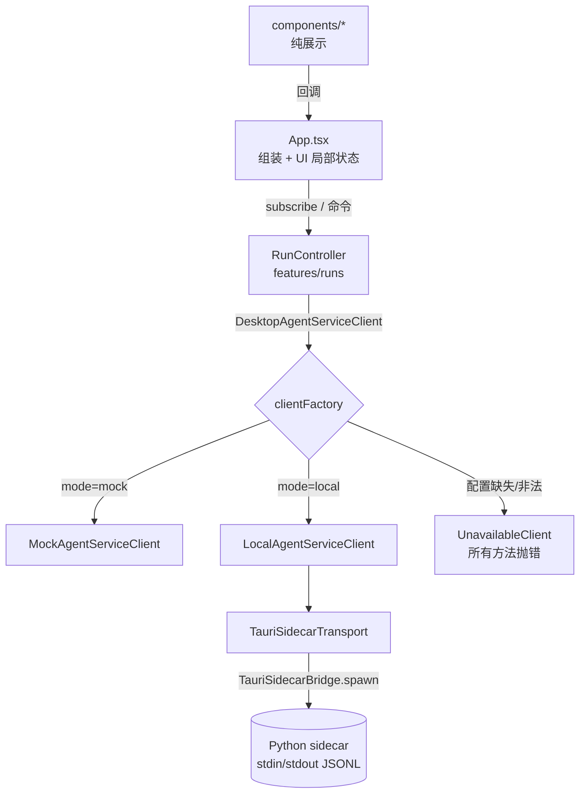

# TSAgent Studio（apps/desktop）前端技术手册

面向接手 `apps/desktop` 的开发者。讲清楚怎么跑起来、代码怎么分层、数据怎么流动、如何扩展和测试，以及还剩哪些已知技术债。
设计背景和合同细节以 ADR 为准：
[ADR-0021](../../docs/adr/0021-agent-service-and-event-stream-contract.md)、
[ADR-0023](../../docs/adr/0023-cancellation-timeout-contract.md)、
[ADR-0025](../../docs/adr/0025-desktop-local-transport-contract.md)、
[ADR-0026](../../docs/adr/0026-desktop-local-agent-service-client.md)、
[ADR-0027](../../docs/adr/0027-desktop-composition-root-contract.md)。

---

## 1. 定位

TSAgent Studio 是 Python AgentService 的桌面控制台：创建 Run、查看执行状态/阶段/产物/事件、发起 Resume 和 Cancel。

几条硬边界（违反就是 Bug）：

- **前端只看公开 DTO**：页面只能依赖 `src/types/service.ts` 里的 `DesktopAgentServiceClient`，不能导入 Runtime、SQLite、workspace 路径这类概念。
- **Snapshot 是事实，事件只是唤醒信号**：UI 状态一律以 `getRun()` 返回的 Snapshot 为准，事件流只用来驱动增量刷新和展示时间线。
- **不做隐式 fallback**：local 模式配置不全或后端不可用时，显示 `Backend unavailable` / Service Error，**绝不**退回 Mock。
- **前端不做决策**：Resume 用哪个 action、能不能取消、终态是什么，全部来自 Service 投影，UI 不推导、不重算、不调 LLM。

## 2. 快速开始

### 环境

- Node：`^20.19.0 || >=22.12.0`（Vite 7 的要求，见 `package.json#engines`、`.nvmrc`）。
- Python 3：只有 `test:local-client` 里的 LC16 和 `test:desktop4c` 要用，它们会拉起真实的 JSONL sidecar。

```bash
cd apps/desktop
nvm use            # 读取 .nvmrc
npm ci
npm run dev        # http://localhost:4173，默认 Mock 模式
```

### 运行模式

| 模式 | 怎么开启 | 数据源 |
| --- | --- | --- |
| `mock`（默认） | 不设置 `VITE_AGENT_SERVICE_MODE` | `MockAgentServiceClient` + `src/mocks/runData.ts` 剧本 |
| `local` | `VITE_AGENT_SERVICE_MODE=local` + tenant/user 环境变量 + Tauri host 注入 `window.__TSAGENT_SIDECAR_BRIDGE__` | `LocalAgentServiceClient` → `TauriSidecarTransport` → Python sidecar |

```bash
VITE_AGENT_SERVICE_MODE=local \
VITE_TSAGENT_TENANT_ID=tenant-local \
VITE_TSAGENT_USER_ID=user-local \
VITE_TSAGENT_SESSION_ID=session-desktop-local \   # 可选；不填就在 composition root 生命周期内生成一次
npm run dev
```

仓库里**没有** Tauri/Rust host，所以在纯浏览器里开 local 模式只会显示 `PROVIDER_UNAVAILABLE`，这是预期行为。

### 常用命令

| 命令 | 作用 |
| --- | --- |
| `npm run dev` | Vite 开发服务器 |
| `npm run build` | `tsc -b`（只检查 `src`）+ 生产构建，输出到 `dist/` |
| `npm run typecheck` | 对 `src` **和** `tests` 做类型检查 |
| `npm test` | typecheck + 全部离线测试（CI 跑的就是这个） |
| `npm run test:local-client` / `test:desktop4a` / `test:desktop4b1` / `test:desktop4b2` | 单独跑某个测试文件 |
| `npm run test:desktop4c` | 真实本地链路 harness（真 sidecar + 可选真 Provider），会写 `realtest_reports/desktop/`，**不在 CI 中运行** |

## 3. 目录结构

```
apps/desktop/
├── index.html / vite.config.ts / tsconfig.json
├── scripts/run-ts-test.mjs        # 用 esbuild 打包 TS 测试再交给 node 运行（唯一的测试 runner）
├── tests/
│   ├── tsconfig.json              # 测试的类型检查配置（带 @types/node）
│   ├── localAgentServiceClient.test.ts   # LC01–LC16：transport + local client
│   ├── clientFactory.test.ts             # D4A01–D4A06：composition root
│   ├── runController.test.ts             # 4B01–4B04：hydrate / cursor / 去重 / 错误
│   ├── runControllerOperations.test.ts   # B201–B209：Resume / Cancel / 终态
│   └── desktop4cE2EHarness.ts            # 真实本地链路 harness（手动跑）
└── src/
    ├── main.tsx                   # React 挂载点
    ├── App.tsx                    # 组装：创建 client/controller，管 UI 局部状态，分发回调
    ├── components/                # 纯展示组件（只收 props，不碰 Service）
    │   ├── Icon.tsx  StatusBadge.tsx  runDraft.ts
    │   ├── Sidebar.tsx  Topbar.tsx  HomeView.tsx  CreateRunModal.tsx
    │   └── RunInspector.tsx  ConversationPanel.tsx  InspectorPanel.tsx
    ├── features/runs/runController.ts   # 应用层：Run 生命周期、cursor、polling、错误
    ├── service/
    │   ├── clientFactory.ts       # Composition root：mock | local | unavailable
    │   ├── mockAgentService.ts    # Mock Service（带幂等、cursor 过期等语义）
    │   ├── localAgentServiceClient.ts   # wire DTO（snake_case）↔ 公开 DTO（camelCase）
    │   ├── localTransport.ts      # JSONL envelope 编解码 + 方法白名单
    │   ├── tauriSidecarTransport.ts     # 请求关联、超时、进程退出、关闭
    │   └── viewMapper.ts          # 公开 DTO → 视图模型（RunView）
    ├── types/service.ts           # 公开 DTO 与 Client 接口（前后端合同）
    ├── types.ts                   # 视图模型（RunView 等）
    ├── mocks/runData.ts           # Mock 剧本
    └── styles.css
```

## 4. 分层与数据流



每层只负责自己那份不变量：

| 层 | 负责 | 不负责 |
| --- | --- | --- |
| `components/*` | 渲染、把用户操作转成回调 | 调 Service、判断操作是否合法 |
| `App.tsx` | 选中项、Tab、视图、草稿等 UI 状态；把 controller 状态派发给组件 | 业务状态（全部在 controller 里） |
| `RunController` | Run 目录、cursor、事件去重、polling 启停、`operationState`、**唯一的错误状态** | 选 Resume action、生成取消策略 |
| `LocalAgentServiceClient` | 身份校验（`IDENTITY_MISMATCH`）、wire↔DTO 映射、DTO 校验 | 进程生命周期 |
| `TauriSidecarTransport` | 请求 ID、按 ID 关联响应、超时、退出/协议错误、错误消息脱敏 | 业务语义 |

### 4.1 Run 生命周期（RunController）

1. `initialize()`：`ready()` 健康检查 → `listRuns()` → 每个 Run 做 `hydrateRun`（`listArtifacts` + `readEvents(afterSequence=-1)`）→ 对 live 状态（`pending/active/cancelling`）启动 polling。
2. `startRun()`：Service 返回 durable handle 后**马上** `getRun` 并 hydrate，不等终态。
3. polling（默认 250ms）：`refreshRun` → `getRun` → `applySnapshot`：
   - `readEvents({ afterSequence: lastSequence })`，**exclusive cursor**，只返回 `sequence_number > afterSequence` 的事件；
   - 按 `event_id` 去重，再按 `sequenceNumber` 排序合并；
   - 进入终态就停止 polling。
4. `resumeRun()`：直接把 Service 投影出来的 `resume.action` / `checkpointId` 原样发回去，请求 ID 固定为 `${runId}.resume-request`（幂等）。
5. `cancelRun()`：只有 `active` 状态才会发；请求 ID 固定为 `cancel-${runId}`（同一个 Run 重复取消用同一个 ID）。断线、卸载组件、事件重连都**不会**触发取消。

### 4.2 错误模型

- Service/transport 的错误都统一成 `AgentServiceClientError` → `ServiceErrorDTO { code, message, retryable }`。
- `RunController` 是**唯一**的错误来源：操作失败时先把错误写进 `state.error`，然后照样 rethrow（方便测试和调用方 await）。
- UI 只渲染 `controllerState.error`；关闭横幅调用 `controller.dismissError()`。组件层 `.catch(errorShownByController)` 只是为了吞掉已经投影过的 rejection，**不要**在组件里再维护一份错误 state（以前就这么干过，结果横幅关不掉）。
- transport 会把含 traceback / sqlite / 路径 / key 的消息替换成固定的安全文案（`SAFE_MESSAGES`）。

### 4.3 状态与操作

| RunStatus | Cancel | Resume | 说明 |
| --- | --- | --- | --- |
| `pending` / `active` | `active` 时可用 | — | polling 中 |
| `cancelling` | 按钮禁用，显示 Cancelling… | — | 不能渲染成 `cancelled` |
| `blocked` | — | `resume.outcome === "ready"` 时可用 | |
| `completed` / `failed` / `cancelled` / `timed_out` | — | — | 终态；`cancelled`/`timed_out` 会额外显示"保留进度"摘要 |

Local wire 状态到前端状态的映射在 `RUN_STATUS_MAP`（`localAgentServiceClient.ts`）。

## 5. 组件约定

- 组件**只收 props**，不能 import `service/` 或 `features/`，也不能自己 new controller。
- 所有"创建 Run"的输入框共用 `RunDraft`（`components/runDraft.ts`）：`Enter` 提交，`Shift+Enter` 换行，输入法组合输入（`isComposing`）时不提交；内容为空时提交按钮禁用，`createRun` 也会直接 return。**不要**再加"空输入时塞一句默认 prompt"这种静默兜底。
- 选中的 Stage/Artifact 默认值在 `App.tsx` 里**推导**：没选或者选中项不存在时，Stage 优先取 `running/interrupted` 的那个，否则取第一个；Artifact 取第一个。切换或新建 Run 时把选择重置为空即可。**不要**硬编码 Mock 数据里的 ID（比如 `run-2048.solution`）。
- 新增图标：在 `Icon.tsx` 的 `IconName` 和 `iconPaths` 里各加一项（24×24 描边 path）。
- 样式统一写在 `styles.css`，类名用 kebab-case；状态类直接复用 `RunStatus` / `StageStatus` 的值（如 `.status-badge.timed_out`）。

## 6. 扩展指南

### 6.1 新增一个 Service 能力（比如 `list_runs`）

按依赖顺序，**一条主路径，不留兼容分支**：

1. 后端/合同：先改 ADR-0025（JSONL 方法白名单）和 Python sidecar。
2. `localTransport.ts`：把方法加进 `LOCAL_TRANSPORT_METHODS`。
3. `types/service.ts`：加请求/响应 DTO 和 `DesktopAgentServiceClient` 上的方法。TypeScript 会强制 Mock、Local、Unavailable 三个实现都补上。
4. `localAgentServiceClient.ts`：写 wire→DTO 映射，在 trust boundary 校验。
5. `mockAgentService.ts`：实现同样的语义（包括错误码）。
6. `RunController`：接进生命周期，补测试。
7. 最后才改 UI 组件。

### 6.2 新增一个 RunStatus

改 `types.ts#RunStatus` 之后，`statusLabels`（`StatusBadge.tsx`）、`RUN_STATUS_MAP` 等 `Record<RunStatus, …>` 会编译报错，按报错补齐即可；再检查 `isLiveStatus`（runController）和第 4.3 节的表。

### 6.3 新增一个页面区块

在 `components/` 下新建组件，props 用视图模型（`types.ts`），由 `App.tsx` 或 `RunInspector.tsx` 组装。

## 7. 测试

- **框架**：Node 内置 `node:test` + `node:assert/strict`。`scripts/run-ts-test.mjs` 先用 esbuild 把 TS 打包成 ESM 再运行（cwd 为 `apps/desktop`，并注入 `TSAGENT_REPO_ROOT`）。
- **类型检查**：`tests/tsconfig.json` 让测试也走 strict 检查。以前测试只经过 esbuild（会直接剥掉类型），夹具里写错的 DTO 字段（比如 `completedWorkflowIds`）一直没人发现。
- **写 Controller 测试**：参考 `runController.test.ts` 里的 `FakeAgentServiceClient`，它实现了完整的 `DesktopAgentServiceClient`；要模拟异常就继承它，覆盖对应方法。
- **写 transport/client 测试**：参考 `localAgentServiceClient.test.ts` 里的 `StubTransport`（直接塞 wire 响应）和 `FakeSidecarProcess`（模拟进程的 stdout/exit）。
- **用例编号**：沿用前缀（`LC`、`D4A`、`4B`、`B2`），新增用例往后接着编号。
- **测试边界**（见根目录 `AGENTS.md`）：离线测试不代表真实桌面验收；真实 Provider、Tauri host 相关的验证要单独提测试需求。
- **目前还没有 React 组件/浏览器测试**，见第 9 节。

## 8. CI

`.github/workflows/ci.yml` 里的 `desktop-frontend` job：`npm ci` → `npm test`（typecheck + 离线测试，LC16 会用 Python 3.12 拉起真实 sidecar）→ `npm run build`。Node 版本读取 `apps/desktop/.nvmrc`。

## 9. 已知技术债（未处理）

按建议的优先级排列：

1. **没有 UI 层自动化测试**：组件、App 组装、键盘交互都没有测试覆盖。建议接入 Vitest + Testing Library（组件）或 Playwright（端到端，Mock 模式）。
2. **Mock 剧本是视图格式**：`mocks/runData.ts` 写的是 `RunView`，`MockAgentServiceClient` 要先 `toServiceSnapshot/toServiceEvent/toServiceArtifact` 转成 DTO，再由 `toRunView` 转回视图；`RunEventView` 也因此保留了一批可选的重复字段（`type`/`eventType`、`at`/`timestamp`）。应该把剧本直接写成 DTO，然后删掉反向 mapper 和这些重复字段。
3. **local 模式的 Run 列表不完整**：sidecar 没有 `list_runs`，`LocalAgentServiceClient.listRuns()` 只返回当前实例见过的 Run。要靠公开查询合同解决（按 6.1 的流程），**不能**让前端直接读 SQLite。
4. **仓库里没有 Tauri/Rust host**：真实的进程生命周期、身份注入都需要在外部环境验证（见 `docs/quality/known-debt.md` 第 7 条）。
5. **`styles.css` 有多轮叠加覆盖**：文件末尾的 "font-size pass" 和 "Shared shell pass" 会重新定义前面已经写过的规则，`body { min-width: 960px }` 也写死了。建议合并成一处，把颜色/字号抽成 CSS 变量。
6. **polling 固定 250ms，没有退避**：后端持续出错时，每次轮询都会刷一遍错误横幅。可以按 `retryable` 做指数退避。
7. **`startRun` 并发时会静默返回当前 Run**：`operationState !== "idle"` 时 controller 直接返回当前 Run，UI 会把这当成创建成功（关闭弹窗、清空草稿）。应该返回明确的结果或者禁用入口。
8. **请求 ID 的 UUID 生成逻辑重复了 3 处**（`App.tsx`、`clientFactory.ts`、`localAgentServiceClient.ts`），可以收成一个工具函数。
9. **文案中英混杂，没有 i18n**；Mock 的时间戳是 "刚刚" 这样的字符串，没有统一的时间格式化。

## 10. 治理记录

**2026-11 前端技术债清理**

- 修复错误横幅关不掉：App 和 Controller 各维护一份错误状态，关闭横幅只清掉了 App 那份。现在 Controller 是唯一来源，新增 `dismissError()` 和测试 4B04。
- 拆分 `App.tsx`（455 行，大量单行 JSX）为 `components/*`，App 只负责组装。
- 去掉 UI 里硬编码的 Mock ID（`run-2048.solution`、`implementation`、`analysis`），也去掉空输入时静默替换成默认 prompt 的行为。
- 让 UI 提示和实际行为一致：Enter 真的能提交（兼容输入法）、Esc 关闭弹窗；删掉没有实现的 `⌘N`、无效的搜索按钮、过期的阶段标签 `V2.3D-4B1`/`D4B1`；侧边栏显示真实的 tenant/user，不再是假的 "Alex"；system 消息标为 System；任务的 verified/failed 图标改为与 Stage 一致。
- 工具链：开启 `noUnusedLocals`/`noUnusedParameters`；测试纳入类型检查，并修复因此暴露的 3 处测试类型错误；5 个重复的测试脚本合并成 `scripts/run-ts-test.mjs`；新增 `npm test`、`.nvmrc`、`engines`。
- 清理死代码：未使用的导出/导入（`listRunViewsSync`、`listRunsSync`、`LocalMethod`、`LocalHealthSnapshot`、default exports）、重复的 `digestText`、约 28 行没用到的 CSS。
- CI 新增 `desktop-frontend` job。
