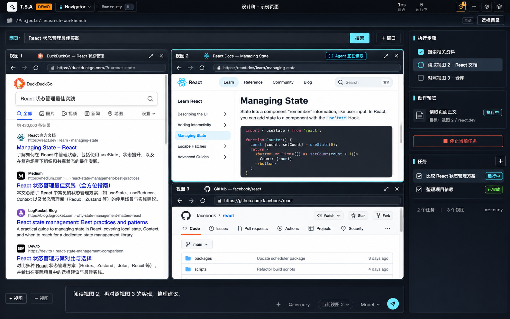

# Mercury 多窗口浏览器工作台实施方案

日期：2026-11-24。状态：设计方向已确认，实施待开始。

用户确认的核心：**一个视图就是一个网站／浏览器窗口；用户和 Agent 操作同一页面。** 本文取代旧方案的“视图是来源资料卡、摘要／正文／快照标签”设计。不是更换主题，而是在现有 Mercury 布局内接通真正的网页工作台。



图中页面内容、任务和数字均为设计示例；正式界面的运行数量、状态、目录和耗时必须来自实际记录，不照抄图中的占位数值。

## 1. 最终使用体验

1. 进入 Mercury，顶部仍是现有星球导航和本台目录栏。
2. 输入网址打开页面，输入关键词打开搜索网站；搜索结果链接可以在当前窗口或新窗口打开。
3. 同时保留 1–4 个独立网页视图，各有标题、实际 URL、返回／前进、刷新、展开和关闭。视图数量上限沿用当前界面，不是任务数量上限。
4. 例如：视图 1 是搜索引擎，视图 2 是官方文档，视图 3 是 GitHub。窗口内容是网页本身，不是提取后重排的摘要。
5. 在底部输入“读取视图 2，再和视图 3 比较”。提交时绑定明确的窗口身份，之后点选其他窗口不会改变已经接纳任务的目标。
6. Agent 操作时对应窗口出现青色标记，右侧显示实际执行步骤、待审批动作和结果。一个任务可使用多个窗口。
7. 用户可以接管窗口；接管完成后明确交还 Agent。任务结束后网页继续留在工作台。
8. 研究结果仍通过既有委派链交给 Mars，带研究输出和来源，不把浏览器登录态或整个浏览器交给子任务。

布局保留：左侧多窗口、右侧约 280px 动作／任务区、底部共享 Composer。三窗口采用设计图的左一右二；单窗口铺满，两窗口并排，四窗口 2×2。展开只占左侧主区，返回保持原窗口。首版不做任意拖拽布局编辑器。

## 2. 代码基线与实际差距

| 当前实现 | 可复用部分 | 必须改变的部分 |
| --- | --- | --- |
| [MercuryWorkspace](../../apps/desktop/src/workspaces/mercury/MercuryWorkspace.tsx) | `nav2/nav-main/nav-side`、目录、Composer、WorkspaceTasks | `search.panes` 现在是搜索结果卡；右栏只是本地搜索日志；Stop 只停止搜索 |
| [searchSession](../../apps/desktop/src/workspaces/mercury/searchSession.ts) | 已有请求归属经验；搜索服务仍可供研究调用 | 不能继续把来源数量当作浏览器窗口数量 |
| [BrowserSession](../../agent/browser/session.py) | Playwright Chromium、出口代理、网页读取与错误页识别 | 当前每 Run 一个 Page，没有窗口目录、显示流、人工输入或跨 Run 窗口生命周期 |
| [工具目录](../../agent/loop/toolset.py) | 现有 browser 工具及风险等级 | 操作默认“当前唯一页面”；需要明确视图身份和当前可操作窗口清单 |
| [ExecutionStage](../../agent/orchestrator/executor.py)、[PlanExecutor](../../agent/executor/plan_executor.py) | 统一工具执行、审批、事件、来源证据、截图产物 | 向执行上下文传入明确的目标窗口；不能加新的模型执行旁路 |
| [AgentLoop](../../agent/loop/runner.py) | 结束、异常、取消的释放入口 | 当前 finally 关闭浏览器；不能因此关闭用户仍在看的工作台窗口 |
| [Tauri 配置](../../apps/desktop/src-tauri/tauri.conf.json)、[宿主桥](../../apps/desktop/src/service/tauriBridge.ts) | Sidecar 进程及现有本地通信，loopback 连接 CSP | Mars 的 code-server iframe 不是通用网页浏览器，也不能控制现有 Playwright Page |

基线以当前工作树为准，包括尚未提交的浏览器读取修复。实施前先记录实际基线提交与该补丁状态，不能覆盖已有改动。

## 3. 技术路线：同一 Chromium 页面，两个操作者

推荐先验证并采用 **现有 Sidecar 管理 Chromium，前端接收实时页面画面并回传人工输入**。Agent 仍通过 Playwright 操作那个 Page。

```text
Mercury 窗口框架：地址栏 / 布局 / 焦点 / Composer / 任务区
             │ 显示帧、人工键鼠        │ 任务请求 + 窗口引用
             ▼                       ▼
       Sidecar 浏览器窗口管理     现有 Agent → 审批 → Executor
             └────────── 同一个 Playwright Page ─────┘
                                  │
                         现有 EgressProxy → 网站
```

### 为什么选这条路

- Tauri 在 macOS 使用 WKWebView；项目现有自动化使用 Chromium。把远程网站直接放进另一块 WebView，不能自然获得同一 DOM、Cookie 与导航历史。[Tauri 官方说明](https://v2.tauri.app/reference/webview-versions/)
- Playwright 可对既有 Chromium Page 建立 CDP 会话，适合让显示和输入接到同一目标。[Playwright 官方 API](https://playwright.dev/python/docs/api/class-browsercontext#browser-context-new-cdp-session)
- CDP 提供页面画面流和输入接口，可作为首轮探针的直接实现。画面流接口标为实验性，必须在仓库实际使用的 Chromium 上验证，不把文档存在等同于已可用。[Page 协议](https://chromedevtools.github.io/devtools-protocol/tot/Page/#method-startScreencast)、[Input 协议](https://chromedevtools.github.io/devtools-protocol/tot/Input/)

这是一种可交互的浏览器画面，不是本地嵌入网页 DOM：中文输入、文本选择／复制、滚动、焦点和显示延迟都必须验证。若探针不能满足基本浏览体验，先调整承载方案，不能用周期截图充作完成品，也不同时维护两套浏览器后端。

不采用任意远程 iframe，不移除网站自己的嵌入限制，不更换 Electron，也不新增一套网页抓取／HTML 重写代理。

### 显示通道与执行通道

- 窗口创建／关闭、导航与任务接纳走现有 Service 合同与 JSONL；显示帧和高频人工输入使用同一 Sidecar 内的一条本地流通道，避免大画面堵住审批、取消、health。
- 流通道只绑定 loopback，使用通过可信宿主通道获得的实例凭据并核对 Origin／窗口归属；不公开 CDP 端口，不接受前端任意 CDP 指令。只开放实际需要的显示和输入消息。
- 前端缩放、滚动坐标、设备像素比与后端 viewport 在同一窗口合同里换算；展示旧帧时不能把点击投到新页面。显示帧带窗口身份、文档代次与尺寸。
- 只订阅可见窗口，停止订阅不关闭页面。丢弃已过时帧，不排队播放旧画面；网络断开显示断开，不继续假装可操作。
- 实时帧只在内存传递，不自动写工作区、不记为截图产物，也不自动生成来源证据。显式截图仍走既有文件授权和 artifact 管线。

## 4. 窗口、会话与 Run 合同

### 4.1 身份与状态

窗口属于当前 Mercury 的 `(tenant_id, session_id)`，后台分配稳定 `view_id`。界面的“视图 2”只是显示序号，删掉视图 1 后不会让已经提交的操作改指另一页面。

窗口公开摘要只包含界面需要的字段：`view_id`、title、实际 url、loading/error、可返回／前进、控制者、关联 run_id、viewport 和文档代次。DOM、Cookie、Playwright/CDP 对象留在后端。前端只持有窗口选择和布局，不另存浏览器真值。

提交任务增加结构化窗口引用，含选定 `view_ids` 与明确的初始目标。不能仅把“窗口 2”拼进 prompt，也不能使用可变的前端当前选中作为执行依据。涉及多个窗口的任务将所选窗口列表提供给模型；每个 browser 动作都携带明确 `view_id`。

### 4.2 生命周期与并行

- 工作台拥有交互窗口；Run 只借用明确绑定的窗口，结束时释放控制，不关闭它们。
- 非 Mercury 的既有浏览器任务仍需要 Run 专属窗口：通过同一窗口管理路径创建，所有者为 Run，结束时关闭。这是两个当前使用场景，不保留旧单页旁路。
- 切工作台／切会话解除显示订阅并清除旧画面；后台运行任务可继续。回到原会话后重新取得该会话窗口。
- 同一个会话内窗口共享一个浏览器 context，允许同网站登录态在窗口间共享；不同会话隔离。Run 专属浏览器仍隔离。首版不导入系统浏览器账号、不持久化 Cookie。
- 不同窗口可由不同任务并行操作；同一个窗口只有一个控制者。接纳时对请求的整组窗口一次检查占用，有冲突就明确提示所占任务，让用户改选／另开窗口，不新增任务排队系统，不把整个 Service 限成一个 running。
- 首版关闭应用会关闭这些浏览器。重启保留持久任务、输出与截图，活网页及登录态不承诺恢复；不为本轮新增浏览器会话恢复数据库。

### 4.3 人工接管

空闲窗口由用户直接浏览。Agent 占用时键鼠不会暗中与模型混用；“接管”先让该 Run 停在现有工具边界、结束当前动作，再移交控制。UI 区分“正在接管”和“已接管”。

归还后 Agent 重新读取当前页面再继续。人工导航后，旧页面上尚未执行的审批动作必须失效，不能批准旧选择器后在新页面执行。审批绑定窗口和文档代次；校验落在动作执行边界。

关闭被占用窗口不能让 Agent 转向其他窗口：先停止使用它的任务或在操作确认中明确终止，等待释放后关闭。普通空闲窗口立即关闭。

人工键鼠走限定的用户输入通道，不伪造为模型动作；Agent 点击／输入继续 R2 审批。二者共用浏览器与出口边界，但不因此产生第二条 Agent 证据管线。

## 5. 前端实施内容

| 区域 | 行为与实现约束 |
| --- | --- |
| 顶部 `web:` 栏 | 网址打开到选中窗口；关键词打开固定搜索网站的结果页。首版沿用 DDG，无搜索引擎配置系统。原 `webSearch` 服务继续供研究工具等调用，但不再用它的 sources 填充窗口主体 |
| 窗口标题／地址栏 | 标题与重定向后的地址来自真实 Page；返回、前进、刷新操作该窗口；地址输入与页面实际地址分开，提交后等真实导航结果 |
| 页面区域 | 呈现实时网页，可点击、滚动、输入、选择和复制文字；展开只改布局不重建 Page；站点错误页如实显示 |
| 选中状态 | 用户当前选中的窗口与 Agent 正在操作的窗口分别标识；后台动作不抢用户焦点 |
| 弹出窗口／新链接 | `target=_blank` 与 popup 映射成真实新视图，继承所属会话；达到 4 窗口时明确提示且不遗留不可见页面；不自动覆盖旧窗口 |
| 底部 Composer | 保留附件、草稿、模型选择；增加“当前视图／所选视图”的引用入口。编辑期间切窗口，不回写已提交任务目标 |
| 右侧执行区 | 读取当前所选 Run 的实际工具事件，标明 `view_id` 对应窗口；没有计划就只显示已发生步骤，不造未来步骤、百分比或固定在线状态 |
| 审批与控制 | 原动作预览区展示目标窗口、目标页面、动作及允许／拒绝；Stop 明确取消当前 Run，不混同网页停止加载或关闭窗口 |
| 结果与交接 | WorkspaceTasks 保留多任务、会话与委派；结果可展开阅读，引用打开对应网页；“交给 Mars”预填现有委派 Composer，确认才提交 |

“读取正文”仍以成功工具观察为证据；光看到网页或完成导航不算读取。错误／拒绝文档不能计来源。网页里的指令属于页面内容，不能据此改变授权或自动批准动作。

首版浏览范围包含普通 HTTPS 文档／搜索／仓库页面与基础表单。文件上传下载、网站通知／摄像头、复杂拖拽、DRM 视频和浏览器扩展不纳入本轮；这些入口不能悄悄写入宿主文件或默认授权。普通网页不可用须暴露具体原因，不静默退回摘要卡片。

## 6. 工单与交付顺序

所有工单现在都是**待实施**。验收用例优先覆盖具体入口和本轮新增责任，不扩建通用防御框架。

### MB-01：同页显示与输入探针（先决项）

在本地测试站点上，用当前 Chromium 的同一 Page 建立画面流，放进 Tauri 页面；通过点击、滚动、英文／中文输入、选择／复制、窗口缩放验证交互。

证明：用户输入唯一文本，Playwright 读回相同值；Agent 改同一页面，前端看到结果；三个窗口的输入不互串。记录 viewport／DPR 映射、首帧、输入到显示的延迟及 CPU／内存；建议输入反馈 p95 ≤ 200ms、可见活动页约 15fps 作为体验目标，不是已达标承诺。静态页不要求持续刷帧。

交付：小探针、实际数据、一个承载方案结论。不能只用假画面／单张截图验收。按 AGENTS，自动化本地站点属于离线测试；Tauri 中文输入、剪贴板及手感由独立实测验收，不在无证据时宣称通过。

### MB-02：窗口身份与生命周期

改动面：`agent/browser/`、`runtime_context.py`、Service 生命周期、`AgentLoop`。

建立具体窗口管理实现，统一 Page 创建／查找／关闭及 owner；迁移现有 Run 单页调用，删除替代掉的旧拥有关系。Service close 收束所有所属资源；Run finally 只释放自己拥有／借用的资源。

入口验收：同会话三窗独立；跨会话隔离；Run 完成工作台页仍可读；Run 专属页结束关闭；切会话不关后台任务；Service 退出无残留进程。

### MB-03：跨端窗口合同与显示桥

改动面：`agent/service/contracts.py`、Service、本地 dispatcher、TS types/client/mock、Tauri 桥及必要的 CSP。

提供窗口目录、创建／关闭、导航／历史、控制权交接和显示订阅；定义结构化任务窗口引用。控制仍经现有 Service，画面与人工输入接 MB-01 验证过的流通道。只修改必要 CSP，不放开任意远程脚本或 Tauri IPC。

入口验收：真实 Sidecar 子进程启动→两窗建立→导航→接收对应画面；旧会话／旧文档帧不落新窗；显示持续更新期间 health、审批、取消仍可响应；未知窗口与越会话请求被拒。扩 wire fixture，故意改一处窗口字段能让跨端合同测试失败。

### MB-04：Mercury 多窗口 UI

改动面：`MercuryWorkspace.tsx`、具体窗口组件、局部 `mercury.css`、i18n。共享顶栏、目录栏、Composer、WorkspaceTasks 继续复用。

完成 1–4 窗口布局、独立地址栏、展开／返回、焦点、加载／断开／错误状态和新链接行为。将搜索来源卡从 `nav-grid` 撤下；对应无消费者的旧 pane 管理一并删除，不保留成浏览器失败回退。

入口验收：搜索→打开链接→第二窗口→返回／前进；展开不丢表单与滚动；A→B→A 会话切换没有旧帧；窗口关闭后其他窗口身份不变。1440×900 与 Tauri 最小 1100×700 检查布局和键盘访问。

### MB-05：模型操作绑定窗口并统一留证

改动面：`toolset.py`、`orchestrator/executor.py`、`executor/plan_executor.py`、请求合同和 Run 上下文。

让模型获得允许操作的窗口清单，导航／读／点击／输入／截图显式指向 `view_id`；所有 Agent 动作继续走现有执行器。事件增加窗口关联；正文和实际 URL 保持同次读取，截图属于当前 Run 的授权工作区。

入口验收：假 Provider 读窗口 A 的独有事实再对照 B，输出同时命中；发出任务后 UI 选中 C，任务仍操作 A/B；被拒点击无副作用，获批执行有记录；SSRF、错误页无来源、截图授权既有回归保持通过。

### MB-06：接管、并行与右侧控制

完成占用检查、接管／交还、待执行审批失效、真实步骤选择和 Run 取消。复用现有暂停／审批协调器，不新建另一套任务状态机。

入口验收：两个 Run 分别操作 A/B 可并行；第三个请求 A 明确报占用；人工接管后 Agent 不再输入；人工导航后旧审批不能执行；取消 A 的任务不关闭 B、不清空全部工作台。

### MB-07：结果与 Mars 交接

沿用现有 durable 输出、来源、artifact 和 `delegateFromPlanet`。结果引用可以打开对应 URL，不假设重新打开的网页仍是研究当时版本；需要复核旧内容时展示记录中的正文／截图。

入口验收：Mercury 读两个本地页面→产出带 URL 结果→委派 Mars→子模型实际收到独有研究结论→结果卡进入正确子任务。正文、Run、窗口、工作区四种归属分别核对，不把浏览器会话等同于文件目录。

### MB-08：门禁、文档与交接

运行受影响 Python 浏览器／执行器／协议／Sidecar 测试、Desktop `npm test`／`test:orbits`／`test:scenes`／build，改 Rust 则补宿主检查。全部使用离线 Provider 和本地站点；本地私网放行只限测试夹具，生产出口策略不放宽。

最后一次收口再跑适用全量，记录实际计数与跳过原因。更新 UI 能力说明，明确哪些是实时窗口、哪些是历史产物、哪些仍需真实环境验证。

**依赖顺序：MB-01 → MB-02 → MB-03 → MB-04/05 → MB-06 → MB-07 → MB-08。** 不先把完整 UI 画成“已接通”再补浏览器核心。

## 7. 真实环境验收清单（独立范围）

所需：目标 macOS/Tauri、匹配版本的 Playwright Chromium、本地 Ollama、正常公网 DNS 和可访问的测试网站。简单任务优先 Ollama；需要对照模型能力时另记条件。

| 场景 | 操作 | 通过标准 |
| --- | --- | --- |
| 三网站并列 | 搜索页打开官方文档与 GitHub；各自浏览和展开 | 地址、历史、滚动独立，是真网页，不是来源卡 |
| 人工基础操作 | 中文输入、复制一段文字、缩放窗口 | 文本、坐标、焦点正确；记录操作延迟和手感问题 |
| Agent 同页阅读 | 人工展开一段内容，要求 Agent 读取指定窗口 | 读取的是可见页面，引用对应真实读取 URL |
| 人工接管 | Agent 运行中接管、导航、再交还 | 没有交错点击，旧审批不误执行，新页面重新读取 |
| 多任务与切台 | 两窗两个任务，切 Mars 再回 Mercury | 任务独立推进，窗口／Run／会话不串 |
| 输出交接 | Mercury 研究→Mars 实施→返回结果 | 内容实际进入子模型，目录与任务归属正确 |
| 退出清理 | 带打开窗口退出应用 | 所属浏览器与显示通道均关闭，无残留 |

## 8. 完成口径

只有同时做到“真网页可操作、用户与 Agent 同页、多个窗口身份清楚、执行证据归属正确”，才算这版 Mercury 交付。模型是否完成某次研究另外按真实任务评测，不用漂亮截图替代功能验收。

本次仅编写实施方案并保存用户认可的设计图；未修改生产代码、未运行真实业务验证。下一张应实施 MB-01。
