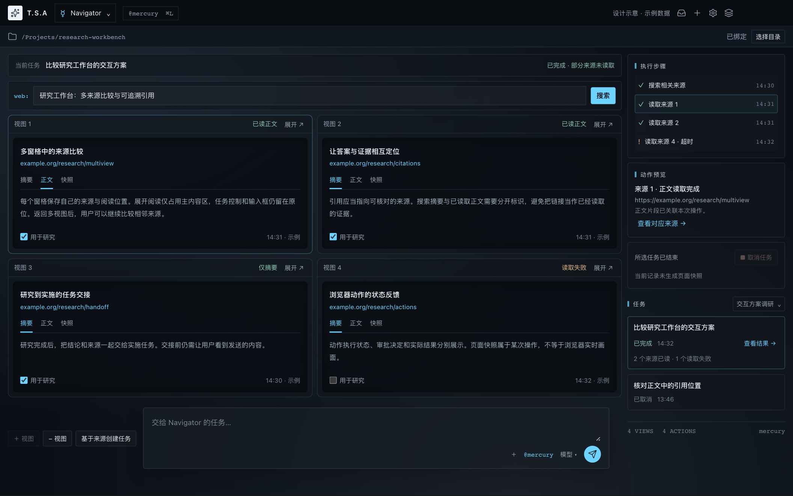

# Mercury 前端体验方案

> 已取代：用户于 2026-11-24 确认“视图是独立网站／浏览器窗口”。后续实施以 [Mercury 多窗口浏览器工作台实施方案](mercury-browser-implementation-plan-2026-11-24.md) 及其设计图为准；本文的来源卡片／正文标签方案保留作历史记录，不再排期。

初稿：2026-11-23；修订：2026-11-24。状态：设计提案，未实现。版本：按当前设计修订；本版替换上一版三栏研究工作台提案。

## 1. 设计基线

以现有 Mercury / Navigator 为基线补齐功能：保留顶栏、目录栏、左侧多视图、右侧控制栏，以及底部共享输入框。正文、页面快照和任务结果在现有主视图区打开。移除上一版新增的左侧研究记录栏和常驻右侧证据阅读器，不改变全局导航结构。

本次只修订设计文档和示意图。示意任务、来源、时间和状态均为示例数据。



### 与代码一一对应

| 现有位置 | 当前实现 | 方案如何接续 |
| --- | --- | --- |
| 应用顶栏 | `App`、`PlanetSwitcher`、TaskTray、Agent dock | 保留 T.S.A 标识、星球下拉、任务托盘与设置入口；不新增左侧星球导航 |
| 顶栏下方目录栏 | `WorkspaceHost` → `WorkspaceDirBar` | 原位保留，展示当前 Mercury 会话实际生效根 |
| 主区任务提示 | `useWorkspaceCurrentRun` → `ws-hud` | 保留紧凑任务标题与状态，不改成大型报告页头 |
| 左侧搜索栏 | `nav-bar`、`webSearch` | 保留“web:”检索输入与搜索按钮；搜索不冒充任务执行 |
| 左侧 1–4 个窗格 | `nav-grid`、`nav-view` | 保留多来源并排比较；每个窗格补“摘要/正文/快照”和展开入口 |
| 底部视图按钮 | `nav-vctl` | 保留增加/减少视图、“基于来源创建任务”；增加返回多视图的明确入口 |
| 底部任务输入 | `AgentComposer` | 沿用附件、@mercury、模型选择、发送及草稿行为 |
| 右侧过程 | `nav-side` → 计划、动作预览、停止 | 原位接实际 Run 事件、审批与操作结果，保持约 280px 的侧栏 |
| 右侧任务列表 | `WorkspaceTasks`、`PlanetSessionPicker` | 原位选会话与任务、看委派；不再新增另一套记录导航 |

核对来源：[MercuryWorkspace](../../apps/desktop/src/workspaces/mercury/MercuryWorkspace.tsx)、[WorkspaceHost](../../apps/desktop/src/app/WorkspaceHost.tsx)、[应用顶栏](../../apps/desktop/src/App.tsx)、[共享样式](../../apps/desktop/src/styles/shared.css)、[共享输入框](../../apps/desktop/src/app/AgentComposer.tsx)、[任务列表](../../apps/desktop/src/app/WorkspaceTasks.tsx)。目前 Mercury 的主要样式在 `styles/shared.css`，`styles/mercury.css` 为空，不能只读独立样式文件判断页面外观。

## 2. 布局只在现有区域内演进

```text
┌ T.S.A │ ☿ Navigator / Mercury ▾ │ @mercury │ 任务托盘 │ 设置 ┐
├ 当前 Mercury 目录 · 项目路径 · 选择目录 / 解绑 ─────────────────┤
│ ┌ 当前任务标题与真实状态 ───────────────────┐ ┌ 计划步骤 ────┐ │
│ ├ web: 搜索输入                    [搜索] ┤ │ 实际操作顺序 │ │
│ ├────────────────────┬────────────────────┤ ├ 动作预览 ────┤ │
│ │ 视图 1             │ 视图 2             │ │ 当前操作详情 │ │
│ │ 摘要/正文/快照     │ 摘要/正文/快照     │ │ 审批也在这里 │ │
│ │ [展开]             │ [展开]             │ ├ 运行控制 ────┤ │
│ ├────────────────────┼────────────────────┤ │ 停止搜索/任务│ │
│ │ 视图 3             │ 视图 4             │ ├ 本台任务 ────┤ │
│ │ 来源及读取状态     │ 来源及读取状态     │ │ 会话选择     │ │
│ └────────────────────┴────────────────────┘ │ 并行任务列表 │ │
│ [+视图][-视图][基于来源创建任务]             │ 委派任务     │ │
│ ┌ 现有 AgentComposer ─────────────────────┐ │              │ │
│ │ 附件  @mercury     模型选择      [发送] │ │              │ │
│ └────────────────────────────────────────┘ └──────────────┘ │
└────────────────────────────────────────────────────────────┘
```

### 窗格展开

点击窗格“展开”，只将左侧 `nav-grid` 切换为该来源的大视图。右侧控制栏、顶部目录和底部输入框仍在原位置。大视图头部提供“返回多视图”，返回后保留各窗格选中来源和阅读位置。

长正文、截图、任务结果共用这个展开区域；不是再加一个常驻阅读器。默认仍为用户原有的 1–4 窗格选择，首版不强制只剩单一报告页。

### 任务结果

从右侧某任务点击“查看结果”，在左侧展开区展示该 Run 的输出和来源引用。点击引用切到对应来源正文；返回任务结果仍属于原 Run。需要继续实施时，“交给 Mars”预填现有 Composer，用户确认发送后进入既有委派链。

## 3. 与现有视觉风格保持一致

- **材质**：沿用深色冷灰底、低饱和背景光、磨砂面板、细边线和内凹内容区。不要换成纯白 SaaS 页面或高对比大卡片。
- **颜色**：Mercury 的识别色继续来自 `SCENES` 的 `#6FD3FF`；底色、面板和文字使用现有 token。重点色用于当前窗格、链接和真实执行状态。
- **比例**：保持 `nav2` 左主区 + 右侧约 280px；现有 8–10px 区域间距、紧凑标题和约 12–14px 操作文字。长正文在展开区可用 14–15px 与更舒适行距，局部改善阅读。
- **输入框**：直接复用当前 `AgentComposer` 的玻璃面板和底部工具行，圆角及尺寸服从现有工作台样式，不另画一套发送控件。
- **装饰**：沿用项目现有星球环境和面板材质，不额外添加仪表盘、可信度分数或新动画。
- **适配**：桌面以现有最小宽度约束为准，先保证 1440px、1280px、1024px 的比例。较窄预览中主区改单列、侧栏下移；不把移动端重做加入本轮。

## 4. 补齐的交互

### 4.1 搜索与任务各守一个入口

顶部搜索框继续做快速搜索；底部 Composer 继续创建任务。按钮与文字直接区分两者，不额外增加首页或“研究/搜索”模式系统。

搜索返回来源后，可以勾选参与研究的来源，点击现有“基于来源创建任务”预填 Composer。用户确认后才发送。任务正在运行时仍可提交其他任务；右侧 `WorkspaceTasks` 保持多任务列表。会话切换由现有 `PlanetSessionPicker` 负责。

### 4.2 一个来源窗格的内容

窗格头保留“视图 N”，增加来源状态和展开按钮。窗格正文区内提供：

| 标签 | 展示内容 | 没有内容时 |
| --- | --- | --- |
| 摘要 | 搜索返回的标题、URL、摘要 | 搜索无结果或失败使用现有明确状态 |
| 正文 | 实际读取并留存的安全正文片段 | “尚未读取”或“正文未留存”，提供“发起读取任务” |
| 快照 | 与该来源/操作明确关联的已生成截图 | “尚未生成页面快照”，不借别的 Run 的截图占位 |

来源状态区分“仅摘要”“已读正文”“读取失败”。“已读”不等于事实已核实；导航成功不等于读到正文；出现在模型回答里的 URL 也不自动升级成成功读取来源。截断内容注明“片段”。

“发起读取任务”复用现有接纳路径，明确要求读取该 URL。它不会在前端新增直连抓取通道，也不保证模型仅因看到按钮就一定完成读取。

### 4.3 右侧计划与动作预览

计划区域呈现当前所选 Run 的实际操作顺序。没有真实计划时，标题可以改为“执行步骤”，只列已经开始/结束的操作，不补造未来步骤和百分比。

点击步骤在原“动作预览”块展示对应目标、状态、来源或错误。选择历史步骤后保持该选择，后台更新不抢走正在阅读的内容。搜索日志与 Run 执行步骤明确标识归属，不混成同一条时间线。

需要审批的点击/输入在动作预览块展开“允许这次操作 / 拒绝”，复用现有审批接口和服务端脱敏。批准表示授权，操作成功仍等待执行结果；拒绝则没有执行副作用。

### 4.4 停止与能力状态

保留现有控制区域，但文案必须明确对象：“停止搜索”仅作废该搜索的在途响应；“取消任务”针对当前所选 Run，并显示“正在取消”直到真实终态。沿用任务条目已有暂停/取消行为，不让全局选中 Run 控制到其他工作台。

移除固定的“浏览器能力未安装”结论。尚无运行证据时显示“尚未使用浏览器”；遇到具体依赖缺失或访问阻断后显示实际错误。不是把固定未安装简单换成固定 ONLINE。

### 4.5 页面快照的边界

首版展示已生成快照，并在有记录时标注时间、来源 URL 和所属步骤。它不是实时画面。浏览器随 Run 结束关闭后，历史快照仍可查看，但不出现可操作的地址栏、返回/前进或“接管”按钮。

不自动每步截图，不因进入快照标签申请写文件权限。若要增加实时画面或人工接管，另行确定后端合同后再设计。

## 5. 数据工作限定在界面真正需要的范围

现有 `webSearch`、Run head/输出、事件、审批、任务目录和 `readArtifactPreview` 继续使用。前端不再建会话/任务模型，不另存一份执行终态。

当前公共 `task_completed` 事件主要包含状态、错误码等，并不保证带完整正文。正文和来源联动需要一份 **Run 范围的只读证据投影**：从现有持久执行结果提供关联任务/事件 ID、操作结果、实际来源 URL、安全正文片段与截断标记、已有截图 artifact_id、公开错误摘要。

实施前用持久化 fixture 核对字段：已有则扩公开投影；确实缺少新运行所需内容时，在统一执行结果记录处补齐。不要解析 stdout/stderr 或模型回答来拼证据，不新建证据数据库。历史记录缺项就显示缺项。

多窗格展示是对同一份真实结果的投影；切会话、切任务、切来源时沿用请求归属/序号机制。任何迟到响应不得将 A 的正文、截图或错误显示到 B。

## 6. 修订后的实施工单

| 工单 | 在哪里改 | 交付及验收 |
| --- | --- | --- |
| MFE-01 现有页面补齐 | `MercuryWorkspace`、`nav-*` 局部样式 | 保留顶栏/目录/多窗格/右栏/Composer；给窗格加内容标签与展开；两个并行任务都可选可控，不新增记录侧栏 |
| MFE-02 证据读取合同 | Service 投影 + Python/TS fixture | 正文与成功读取时的 URL 配对；失败不计已读；截图只关联真实产物；重启后已有记录可读 |
| MFE-03 窗格内容接入 | 来源窗格及其展开区 | 摘要、正文、快照状态诚实；展开/返回保留选择；A→B→A 迟到响应不串内容 |
| MFE-04 右栏执行闭环 | 原计划/动作预览/控制区 | 实际步骤可选；批准后等结果、拒绝无副作用；取消显示真实过程；删除固定未安装文案 |
| MFE-05 结果与 Mars 交接 | 任务列表“查看结果” → 主视图区 → 现有 Composer | 结果可在 Mercury 阅读；引用能定位来源；交接带当前 Run 输出；进入正确 Mars 子任务并能回原记录 |
| MFE-06 验收与文档 | DOM、跨端 fixture、构建与能力说明 | 样式与当前工作台一致；多任务/会话/来源切换不串；无图/无正文/错误状态可用；离线与真实验收分别记录 |

顺序：MFE-01 → MFE-02 → MFE-03/04 → MFE-05 → MFE-06。MFE-01 先用明确标识的 fixture 做交互，再接数据；不能把原型状态当成已接通功能。

离线验收：React DOM 延迟响应、真实 sidecar + 假 Provider、本地 Chromium、wire fixture、typecheck/npm test/orbits/scenes/build。真实验收：Tauri 中搜索、读取指定来源、查看截图、审批后执行，以及研究结果委派 Mars。后者需要可用模型、浏览器依赖与测试站点，不能由离线测试替代。

## 7. 修订边界

本版撤回上一版“左侧研究记录 + 中央报告 + 右侧常驻证据”的整体换版建议。当前 `MercuryWorkspace` 和共享组件是布局权威；旧 `planet-workspace-ui.md` 的实时视口/接管内容仍是未实现设想，不据此扩展本轮范围。

未改生产前端；浏览器后端工作树中的修复不属于本次设计修改。

## 8. 本次设计检查

已用当前代码的独立 mock 页面核对顶栏、目录栏、多窗格、280px 右栏和底部输入框的位置及材质，并据此重画示意图。

示意原型已在本地 Chromium 检查：窗格展开/返回、摘要/正文/快照切换、动作选择、结果与来源定位、Mars 草稿预填、视图增减及来源勾选。1440px 主图与 1024px 排版已截图检查；1280/1024/736/390/320px 无横向溢出，未出现脚本错误。小尺寸检查仅保证对话内示意可阅读。

以上是设计原型检查，数据为示例，未向后端提交任务，不是生产功能或真实研究链验收。
